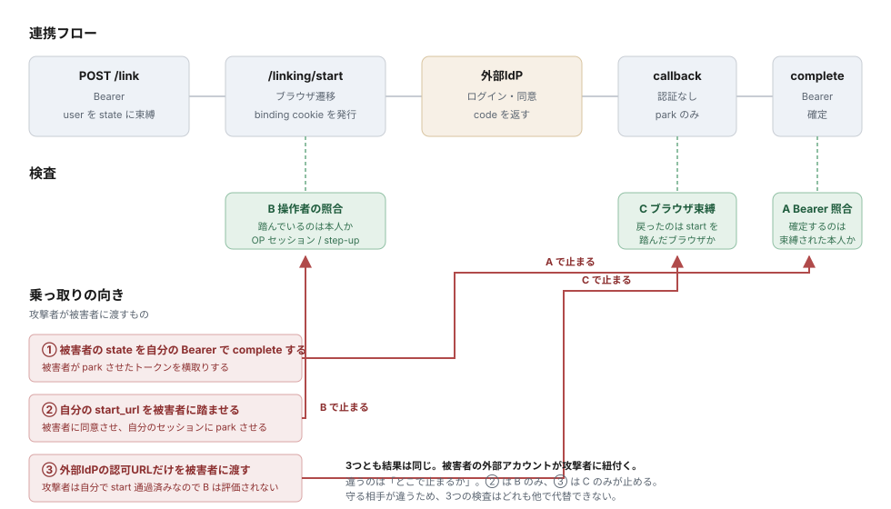

# 外部IdPアカウント連携

## 概要

認証済みのユーザーが、自分のアカウントに**外部IdPのアカウントを追加で紐付ける**ための idp-server 独自のプロトコル拡張です。紐付けの過程で外部IdPが発行したアクセストークンとリフレッシュトークンを暗号化して保管し、後から外部APIの呼び出しに使えるようにします。

既存の Federation（外部IdPでログインする機能）とは目的が異なります。

| | Federation | アカウント連携 |
|---|---|---|
| 目的 | 外部IdPで**ログインする** | 外部IdPのトークンを**保管する** |
| 起点 | 未認証の認可リクエスト | 認証済みユーザーの操作 |
| 紐付け数 | 1ユーザー1件 | provider ごとに複数可（`account_alias` で識別） |
| トークン | 平文 JSONB | アプリ層で AES-GCM 暗号化 |

両者は独立した系統です。連携を追加しても Federation の動作は変わりません。

---

## シーケンス

```
RPアプリ                       idp-server                    外部IdP
 │                                │                              │
 ├─ POST /v1/me/linked-external-accounts/link/{provider} ───────▶│
 │   Authorization: Bearer         │  Bearer から user を確定      │
 │                                │  redirect_uri を allow-list 照合
 │◀─ 201 { start_url, state }      │  連携セッションを保存 (pending)
 │                                │                              │
 ├─ location.href = start_url ────▶                              │
 │                                │  操作者 == セッションの user か
 │                                │  を照合 (authorized)          │
 │◀─ 302 外部IdPの認可URL ──────────┤                              │
 ├────────────────────────────────┼─────────────────────────────▶│
 │                                │        ユーザーがログイン・同意 │
 │                                │◀─ 302 /v1/linking/callback ───┤
 │                                │                              │
 │                                ├─ token 交換 (code_verifier) ─▶│
 │                                │◀─ access_token / refresh_token│
 │                                ├─ userinfo ──────────────────▶│
 │                                │  暗号化してセッションに預ける   │
 │                                │  (parked)                    │
 │◀─ 302 return_to?linking=done&state=                            │
 │                                │                              │
 ├─ POST /v1/me/linked-external-accounts/complete ──────────────▶│
 │   Authorization: Bearer { state }  Bearer と セッションの user  │
 │                                │  を照合して確定 (consumed)     │
 │◀─ 201 { alias, provider, ... }  │                              │
```

認可コードは idp-server の中で交換されて完結し、**RPには渡りません**。

---

## エンドポイント体系

### RPが呼ぶもの（Bearer 必須）

| エンドポイント | 用途 | 必要な scope |
|---|---|---|
| `POST /{tenant-id}/v1/me/linked-external-accounts/link/{provider}` | 連携の開始。`{ redirect_uri, scope }` を受け取り `{ start_url, state, expires_in }` を返す | `linked_account:manage` |
| `POST /{tenant-id}/v1/me/linked-external-accounts/complete` | 連携の確定。`{ state }` を受け取る | `linked_account:manage` |
| `GET /{tenant-id}/v1/me/linked-external-accounts` | 連携一覧 | `linked_account:read` または `linked_account:manage` |
| `DELETE /{tenant-id}/v1/me/linked-external-accounts/{alias}` | 連携の解除。成功時は 204 | `linked_account:manage` |

scope が足りないときは `403` `{ "error": "insufficient_scope", "scope": "..." }` を返します。

scope は「連携を見る」（`read`）と「連携を管理する」（`manage`）の 2 つに分けています。連携の追加と解除は分けません。管理する画面は両方を使い、外す連携を選ぶには一覧も要るので、`manage` は一覧も含みます。保管トークンの取得（`linked_account:read_token`）は別の許可で、`read` / `manage` のどちらにも含まれず、どちらも含みません。

連携の確定は、連携を始めたクライアントのトークンでしか受け付けません。同じユーザーでも、別のクライアントのトークンでは `403` になります。

`{provider}` には連携先の設定名（`sso_provider`）を指定します。

`redirect_uri` は連携完了後にブラウザを戻す先で、開始時にクライアント設定の allow-list と完全一致で照合されます。

### クライアントが呼ぶもの（クライアント認証）

| エンドポイント | 用途 |
|---|---|
| `POST /{tenant-id}/v1/linked-external-accounts/{alias}/token` | 保管している外部IdPのアクセストークンを取り出す |

保管トークンの取得は、[下の節](#保管トークンの取得)で説明します。

### ブラウザ遷移（Bearer なし）

| エンドポイント | 認証 | 用途 |
|---|---|---|
| `GET /{tenant-id}/v1/linking/start?state=` | ブラウザセッション | 操作者を検証し、外部IdPの認可URLへ 302 |
| `GET /{tenant-id}/v1/linking/callback/{provider}?code&state` | `state` + ブラウザ束縛 | 認可コードを交換し、`redirect_uri` へ 302。パスの `{provider}` は使わず、`state` が指す連携セッションの連携先で処理する |

この2本が `/me` の外にあるのは、どちらもブラウザのトップレベル遷移で Bearer を運べないためです。`/me` は `ProtectedResourceApiFilter` によって Bearer 前提で保護されている名前空間なので、そこに未認証エンドポイントを混ぜると、実装者が「フィルタが通っているはず」と誤認する余地が生まれます。

一覧のレスポンスにトークンは含まれません。返るのは `alias` / `provider` / `federated_username` / `scope` / 各有効期限 / `created_at` / `updated_at` です。

解除は呼び出したユーザー自身の連携だけが対象で、他人の `alias` を指定しても 404 になります。行を消す前に、保管しているトークンを外部IdPの失効エンドポイント（RFC 7009）で失効させます。行を消すだけでは、写し取られたトークンが外部IdP側で有効なまま残るためです。

失効はベストエフォートです。次の場合でも連携は解除されます。外部側の都合で解除できないと、ユーザーが連携を取り消せなくなるためです。

- `revocation_endpoint` が設定されていない
- 外部IdPに届かない、または失効を拒否された

連携先の設定を無効化（`enabled: false`）していても、失効は行います。無効化で止めるのは新しい連携であって、発行済みトークンの後始末ではないためです。

解除は行ロックを取ってから失効させます。保管トークンの取得が同時にリフレッシュしていると、外部IdPがトークンをローテーションした直後に古いトークンだけを失効させてしまうためです。

ユーザーが削除されたときも、同じ手順で全ての連携を失効・削除します。あわせて、そのユーザーが始めた連携セッションも削除し、コールバックまで進んで確定されていないセッション（`parked`）が預かっているトークンは失効させます。本人がいなくなると、Bearer を要する `complete` は二度と通らないためです。`linked_external_accounts` は `user_id` に外部キーを張っていないため、ユーザー削除のライフサイクル処理（`LinkedExternalAccountDeletionExecutor`）が後始末を担います。

---

## 確定を分ける理由

外部IdPからのコールバックはブラウザのリダイレクトで届くため、`Authorization` ヘッダを持ちません。つまりコールバック自身には「これが誰の連携か」を確かめる手段がありません。

そこでコールバックでは連携を確定させず、交換したトークンを暗号化して**連携セッションに預けるだけ**にします。確定するのは、Bearer を持つ `complete` だけです。

```
pending ──[start] 操作者を照合──▶ authorized ──[callback] コード交換──▶ parked ──[complete] Bearer 照合──▶ consumed
```

各遷移は条件付き UPDATE による単回消費です。コールバックでは**コードを交換する前に**状態を取りにいき、競合に負けた側が認可コードに触れないようにしています。認可コードは単回のため、二重に使うと外部IdP側で認可ごと失効させられる場合があります。

### 同一性の検証は3箇所に要る

連携の乗っ取りには向きが3つあり、止まる場所がそれぞれ違います。3つの検査は守る相手が違うため、どれも他で代替できません。




| # | 攻撃者がすること | 止まる場所 |
|---|---|---|
| 1 | **被害者の `state`** を自分の Bearer で `complete` する | `complete`（Bearer と照合） |
| 2 | **自分の `start_url`** を被害者に踏ませる | `/linking/start`（操作者と照合） |
| 3 | **自分で `/linking/start` を通り、外部IdPの認可URLだけ**を被害者に渡す | **コールバック（ブラウザ束縛と照合）** |

3つとも成立した場合の結果は同じで、**被害者の外部アカウントが攻撃者のレコードに紐付きます**。攻撃者が欲しいのは被害者のトークンだからです。逆向き（攻撃者の外部アカウントが被害者に紐付く）を成立させるには被害者の `state` で `/linking/start` を通す必要があり、2 と同じ検査で落ちます。

違うのは結果ではなく**どこで止まるか**です。

1 は `state` を握っていても Bearer が一致しないため `complete` で落ちます。

2 は `complete` では落ちません。`state` を握っているのは攻撃者なので、攻撃者自身の Bearer で確定できてしまいます。`/linking/start` で操作者を照合することで、被害者が外部IdPに到達する前に止めます。

3 が厄介です。**攻撃者は `/linking/start` を自分で通過できます**（攻撃者こそが束縛されたユーザーなので、操作者照合は正常に通ります）。そこで返る `302` の `Location` には、外部IdPの認可URLが `state` も `code_challenge` も込みで完成した形で載っています。それだけを被害者に渡せば、被害者は `/linking/start` に一切触れずに外部IdPへ行き、コールバックだけが被害者のブラウザで発火します。**操作者照合は被害者に対して一度も評価されません。**

これを止めるのがブラウザ束縛です。`/linking/start` は乱数の秘密値を発行し、そのハッシュだけをセッションに保存して、値そのものは `IDP_LINK_BINDING` Cookie でブラウザに渡します。コールバックはこの Cookie を要求し、**認可コードを交換する前に**照合します。被害者のブラウザはこの Cookie を持たないため、被害者の認可コードは交換されません。

:::info Cookie の `SameSite` はテナント設定に従いません
コールバックは外部IdPからのクロスサイトのトップレベル GET です。`SameSite=Lax` はこの遷移をちょうど許可しますが、`Strict` だと Cookie が送られず連携が必ず失敗します。そのため `IDP_LINK_BINDING` は `Lax` 固定で、テナントの `cookie_same_site` には従いません。
:::

`/linking/start` は idp-server のブラウザセッションから操作者を解決します。セッションが無い場合は、戻り先へ `linking=failed&error=login_required` を返します（[ブラウザ遷移の失敗](#ブラウザ遷移の失敗)）。

### RP 側の前提: トップレベル遷移で開くこと

RP と idp-server が別ドメインでも連携は成立します。Cookie が要る2箇所はどちらもトップレベル遷移で、`SameSite=Lax` はまさにその経路を許可するためです。`SameSite` が制限するのは Cookie の送信であって保存ではないので、クロスサイトの遷移先で `Set-Cookie` を受け取ること自体は妨げられません。

| 局面 | サイト関係 | 種類 | 結果 |
|---|---|---|---|
| `/linking/start` で発行 | RP → idp-server | トップレベル遷移 | 保存される（遷移先が first-party になる）|
| コールバックで送信 | 外部IdP → idp-server | トップレベル GET | 送られる |

:::warning iframe の中では成立しません
iframe に埋め込むと third-party 文脈になり、Safari の ITP と Chrome のサードパーティ Cookie 制限によって**保存の時点で**落ちます。`location.href` などで**トップレベル遷移**させてください。別ウィンドウ（ポップアップ）は独立したトップレベル閲覧コンテキストなので問題ありません。
:::

外部IdPが `response_mode=form_post` で返す場合も成立しません。クロスサイトの POST には `Lax` の Cookie が送られないためです。コールバックは GET のみを受け付けます。

---

## 設定

### 連携先IdP

`federation-configurations`（`type: oidc`）に登録します。`redirect_uri` には連携用コールバックを指定します。

```json
{
  "type": "oidc",
  "sso_provider": "example-idp",
  "enabled": true,
  "payload": {
    "provider": "standard",
    "issuer_name": "example-idp",
    "issuer": "https://idp.example.com",
    "jwks_uri": "https://idp.example.com/jwks",
    "authorization_endpoint": "https://idp.example.com/authorize",
    "token_endpoint": "https://idp.example.com/token",
    "revocation_endpoint": "https://idp.example.com/revoke",
    "userinfo_endpoint": "https://idp.example.com/userinfo",
    "client_id": "...",
    "client_secret": "...",
    "client_authentication_type": "client_secret_post",
    "redirect_uri": "https://api.example.com/{tenant-id}/v1/linking/callback/example-idp",
    "scopes_supported": ["openid", "email", "offline_access"],
    "userinfo_mapping_rules": [
      { "from": "$.http_request.response_body.sub", "to": "external_user_id" },
      { "from": "$.http_request.response_body.email", "to": "email" }
    ],
    "refresh_token_expires_in": 86400
  }
}
```

外部アカウントの識別子（`federated_user_id`）は、ID Token が返れば検証した `sub`、無ければ userinfo の `external_user_id` へのマッピングから取ります。どちらも無い連携先（OAuth 2.0 の委譲だけ）でも連携できますが、同じ外部アカウントかを判定できないので、連携するたびに新しい連携として増えます。

`scopes_supported` は `link` のリクエストで `scope` を省略したときの既定値です。

`openid` を要求する場合は `issuer` と `jwks_uri` が要ります。返ってきた ID Token の `iss` と署名を、この 2 つで検証するためです。足りないと検証に失敗し、戻り先へ `server_error` を返します。

外部IdPのトークン応答に `expires_in` が無い場合、アクセストークンの有効期間は 1 時間とみなします。連携したときもリフレッシュしたときも同じです。

`refresh_token_expires_in` はリフレッシュトークンの有効期間です。トークン応答はリフレッシュトークンの期限を返さないため、この値で期限を決めます。未設定なら期限は「不明」として扱い、アクセストークンが切れたらリフレッシュを試して、外部IdPの応答に従います。

`revocation_endpoint` は解除とユーザー削除のときに保管トークンを失効させる先です。省略すると、外部IdP側のトークンは失効させずに連携だけを削除します。クライアント認証はトークンエンドポイントと同じ方式で行います。`client_authentication_type` が `client_secret_basic` なら Basic 認証、それ以外はリクエストボディの `client_secret` です。`private_key_jwt` などには対応していません。

`duplicate_link_policy` は、同じ外部アカウントが既にテナント内の別ユーザーに紐付いている場合の挙動です。

| 値 | 挙動 |
|---|---|
| `reject`（既定） | 409 を返す |
| `allow` | 複数ユーザーがそれぞれ自分の連携として保持できる |

**データベース側では一意制約をかけていません。** 保管している外部アカウント識別子は識別子であって identity ではなく（この値で認証する経路はありません）、一律に禁止すると共用の法人アカウントのような正当なケースを塞ぐうえ、先に連携した側が本来の持ち主を締め出せてしまうためです。ログイン用の Federation は `idp_user` 側に一意制約を持っており、そちらは「1つの外部 identity が2人に解決されない」ことを担保する必要があるので事情が異なります。

:::warning ログイン用の設定とは分けてください
連携はAPIアクセス用のスコープ（例: `drive.readonly`）を要求し、コールバック先も異なります。ログイン用の設定を共用すると、ログインの同意画面にAPIスコープが現れます。
:::

### クライアント

連携の API を呼ぶクライアントは、ユーザーのトークンで `linked_account:read` / `linked_account:manage` を得る必要があります。テナントの `scopes_supported` と、クライアントの `scope` の両方に追加してください。どちらかが無いと scope が付与されず、常に `403` になります。

連携完了後の戻り先を `extension.linking_return_uris` に登録します。

```json
{
  "extension": {
    "linking_return_uris": ["https://rp.example.com/linking/callback"]
  }
}
```

認可の `redirect_uris` とは分けています。連携後の戻り先は通常アプリの設定画面であり、認可コードを受け取るURLではありません。流用すると、本来コールバックでないURLに認可コードを飛ばせるようになります。

`extension.linking_providers` には連携の開始を許す連携先、`extension.linking_token_providers` には保管トークンの取得を許す連携先（どちらも `sso_provider`）を列挙します。列挙していない連携先への `link` は `403`、そのトークンの取得は `403 unauthorized_client` です。

```json
{
  "extension": {
    "linking_providers": ["example-idp"],
    "linking_token_providers": ["example-idp"]
  }
}
```

`link` の `scope` は、連携先の設定の `scopes_supported` の範囲に限ります。外部IdPには idp-server の外部クライアントの名義で要求するため、範囲を決めるのは運用者で、RP はそれを狭めることしかできません。範囲外の値は `400` です。

### 暗号化

トークンはテナントごとのデータ鍵（DEK）で AES-GCM 暗号化して保管します。DEK は鍵暗号化鍵（KEK、環境変数 `ENCRYPTION_KEYS`）で包んで `tenant_data_keys` に置き、行の `encryption_key_id` は DEK の id を指します。

- 暗号化ごとに乱数の salt から鍵を派生させ、暗号文と一緒に `{version, salt, iv, cipher_text}` として保存します。
- テナント・用途・DEK の id に加えて、ユーザー・連携先・トークンの種類（アクセストークンかリフレッシュトークンか）を AAD に入れます。別のテナントや別のユーザーの行へ書き写した暗号文、2 つのトークンを入れ替えた暗号文は開きません。
- KEK を替えても DEK を包み直すだけで、保管トークンは書き換えません。手順は [データ鍵と鍵暗号化鍵のローテーション](../content_08_ops/commercial-deployment/07-data-key-rotation.md) を参照してください。

`ENCRYPTION_KEYS` が無ければ `ENCRYPTION_KEY` を KEK として使うため、追加の設定なしで動きます。

---

## 保管トークンの取得

連携したアカウントの外部IdPアクセストークンを、クライアントがユーザーに代わって取り出します。

```
POST /{tenant-id}/v1/linked-external-accounts/{alias}/token
Content-Type: application/x-www-form-urlencoded

token={ユーザーのアクセストークン}&client_id=...&client_secret=...
```

次の全てを満たす場合だけトークンを返します。

- クライアントが認証に成功している。public クライアント（`none`）は拒否します
- `token` が有効なユーザーのアクセストークンで、**同じクライアント**に発行され、`linked_account:read_token` スコープを持つ
- `token` が sender-constrained（DPoP・mTLS 証明書・クライアントインスタンス束縛）でない。証明の検証に対応するまで拒否します
- 連携先がクライアントの `linking_token_providers` に含まれている

```json
{
  "access_token": "...",
  "token_type": "Bearer",
  "issued_token_type": "urn:ietf:params:oauth:token-type:access_token",
  "expires_in": 3599
}
```

連携時に付与された scope を保管していれば `scope` も返します。

レスポンスには `Cache-Control: no-store` が付きます。返すのはアクセストークンだけで、リフレッシュトークンは返しません。リフレッシュトークンはこのサーバーが保管して使います。アプリが使うと、ローテーションで保管側のトークンが無効になるためです。

アクセストークンの期限まで 30 秒を切っていれば、保管しているリフレッシュトークンで更新してから返します。同じ連携への同時リクエストは行ロックで待ち合わせ、リフレッシュトークンを二重に使いません。

| ステータス | `error` | 発生条件 |
|---|---|---|
| 400 | `invalid_request` | `token` が無い / sender-constrained なトークン |
| 400 | `relink_required` | リフレッシュトークンが無い・期限切れ・外部IdPに拒否された / 連携先が削除・無効化された。連携し直す必要があります |
| 401 | `invalid_client` | クライアント認証に失敗した / public クライアント |
| 401 | `invalid_token` | `token` が無効・期限切れ・ユーザーを指していない / ユーザーが有効でない |
| 403 | `unauthorized_client` | `token` が別のクライアントに発行された / 連携先が許可されていない |
| 403 | `insufficient_scope` | `token` に `linked_account:read_token` が無い |
| 404 | `not_found` | `alias` がユーザーの連携に無い |
| 502 | `temporarily_unavailable` | 外部IdPがリフレッシュに 5xx を返した、または到達できない |

---

## 管理API

管理者がユーザーの連携を確認・解除するための API です。システムレベルと組織レベルの両方にあります。保管しているトークンはどれも返しません。

| メソッド | パス | 権限 |
|---|---|---|
| GET | `/v1/management/organizations/{organization-id}/tenants/{tenant-id}/users/{user-id}/linked-external-accounts` | `idp:linked-account:read` |
| GET | `.../users/{user-id}/linked-external-accounts/{alias}` | `idp:linked-account:read` |
| DELETE | `.../users/{user-id}/linked-external-accounts/{alias}` | `idp:linked-account:delete` |

システムレベルは `/v1/management/tenants/{tenant-id}/users/{user-id}/linked-external-accounts` から始まる同じ形です。

- 一覧と個別取得は `/me` の一覧と同じ項目に加えて、外部IdP側の識別子 `federated_user_id` を返します。問い合わせの対応で「どの外部アカウントの連携か」を照合するためです。
- 解除は本人の解除と同じ手順です。行ロックを取り、保管トークンを外部IdPで失効させてから行を消します。失効はベストエフォートです。`dry_run=true` を付けると、解除せずに結果だけを返します。
- 解除はセキュリティイベント `external_account_unlinked_by_admin` で記録します。本人の解除（`external_account_unlinked`）と分けているのは、監査で誰が外したかを区別するためです。
- 操作は管理APIの監査ログにも残ります。

権限は `idp:*` を持つロールには自動的に含まれます。権限を明示的に列挙しているロールで使うには、次の手順が要ります。

1. テナントに権限が無ければ作る。権限のレコードはテナントのオンボーディング時に作られるため、それより後に追加された `idp:linked-account:read` / `idp:linked-account:delete` は既存のテナントにありません。`POST .../tenants/{tenant-id}/permissions` に `{ "name": "idp:linked-account:read", "description": "..." }` を送って作成します。
2. 作った権限をロールに追加する。

---

## エラー

### ブラウザ遷移の失敗

`/linking/start` とコールバックはブラウザがトップレベルで開くページなので、失敗しても JSON は返さず、ブラウザを 302 で送ります。送り先は「どの連携の失敗か」と「このブラウザが連携を始めた本人のものか」で決まります。

| 失敗 | 送り先 | `state` |
|---|---|---|
| 外部IdPで拒否された・外部IdPがエラーを返した | 戻り先（`redirect_uri`） | 付ける |
| 外部IdPでのトークン交換・ID Token の検証・userinfo に失敗した、その他の想定外のエラー | 戻り先 | 付ける |
| コールバックに `code` も `error` も無い | 戻り先 | 付ける |
| `/linking/start` にブラウザセッションが無い | 戻り先 | 付けない |
| ブラウザ束縛が一致しない・操作者が一致しない | エラー画面 | — |
| `state` が無い・未知・期限切れ | エラー画面 | — |
| 連携が既に先へ進んでいる（再読み込み・戻るボタン・二重送信） | エラー画面 | — |

戻り先へは次の形で返します。成功時の `linking=done` と揃えています。

```
{redirect_uri}?linking=failed&error=access_denied&state=...
```

- `error` は `access_denied` / `login_required` / `temporarily_unavailable` / `server_error` のどれかです。外部IdPがコールバックに付けてきた `error` は誰でも付けられる値なので、そのまま流さずにこの中から選びます。
- `error_description` と外部IdPの応答本文は返しません。
- `state` は、このブラウザが連携を始めたブラウザだと確かめられたときだけ付けます。`/linking/start` にブラウザセッションが無い場合は確かめられないため、付けません。連携セッションもそのまま残すので、サインインしたブラウザからは続けられます。
- 戻り先は `link` のときにクライアントの `linking_return_uris` と完全一致で照合済みなので、失敗を返してもオープンリダイレクトにはなりません。

戻り先へ返す失敗では、連携セッションを削除します。外部IdPはその認可リクエストに二度と答えず、認可コードも使い直せないためです。拒否もブラウザ束縛を照合してから受け付けるので、束縛を持たないブラウザから他人の連携を終わらせることはできません。

コールバックは、ブラウザ束縛より先に連携の状態を見ます。既に先へ進んだ連携へのコールバックは、多くは同じブラウザの再読み込みです（束縛の Cookie はコールバックで使い終わって消えています）。これを「別のブラウザで始めた連携」として扱わないためです。

失敗はセキュリティイベント `external_account_link_failed` で記録し、連携セッションが分かる場合はそのユーザーとクライアントを付けます。`/linking/start` にブラウザセッションが無いだけの場合は記録しません。セッションが切れただけの日常的なケースで、記録すると束縛や操作者の不一致が埋もれるためです。

エラー画面はテナントの認証画面（`ui_config.base_url`。未設定ならテナントのドメイン）の `/error/` です。認可エンドポイントが戻せないエラーを送る先と同じです。

### API の失敗

`link` / `complete` / 一覧 / 解除のレスポンスは `{ "error": "invalid_request", "error_description": "..." }` の形です。

| ステータス | 発生条件 |
|---|---|
| 400 | `redirect_uri` が未指定、または allow-list に無い / 連携先が設定されていない・無効 / 連携の途中で連携先が削除・無効化された |
| 403 | 操作者が連携セッションのユーザーと一致しない / 確定したクライアントが連携を始めたクライアントと違う / `insufficient_scope`（`linked_account:read` / `linked_account:manage` が無い） |
| 404 | `state` に対応する連携セッションが無い / 解除する `alias` が呼び出したユーザーの連携に無い（`error` は `not_found`） |
| 409 | 連携セッションが期限切れ、または期待する状態でない / 同じ外部アカウントが既に他のユーザーに紐付いている（`duplicate_link_policy: reject` のとき） |

409 のうち重複連携は、誰に紐付いているかを返しません。返すと外部アカウントの所有者を列挙する手がかりになるためです。

同じユーザーが同じ外部アカウントをもう一度連携した場合はエラーになりません。既存の連携が更新され、`account_alias` は保たれます。

---

## 期限切れの連携セッション

期限を過ぎた連携セッションは、期限切れデータの一括削除 `POST /v1/admin/operations/delete-expired-data` で消えます。応答の内訳では `account_linking_session` です。確定されなかったセッション（`parked`）が預かっていた暗号化トークンも、行と一緒に消えます。

外部IdPでの失効はしません。行を消したあとは、そのトークンを持つ者がいないためです。失効させるには行ごとに外部IdPを呼ぶ必要があり、全テナントをまとめて消す一括処理には向きません。外部IdP側の許可は、そのトークンの期限まで残ります。

ユーザーが削除されたときは、期限内のセッションも含めて消し、確定前のトークンは外部IdPで失効させます（エンドポイント体系の解除の説明を参照）。

---

## 未対応の機能

| 項目 | 状態 |
|---|---|
| 期限切れの連携セッションの外部IdPでの失効 | 行わない。削除だけです（下記） |
| テナント削除時の失効 | 未実装。連携の行はテナントの削除に連動して消えますが、外部IdPのトークンは失効しません |
| step-up 認証 | 未実装。`/linking/start` はブラウザセッションが無ければ、戻り先へ `error=login_required` を返すだけです |
| ネイティブアプリ | 上記のため未対応。アプリ内ブラウザに idp-server のセッションが無いと `login_required` で戻ります |
| 外部IdPの `response_mode=form_post` | 未対応。コールバックは GET のみです |
| MySQL | DDL と永続化実装はありますが、MySQL での e2e は未実施です |
| 管理APIでの保管トークンの取得 | 提供しません。管理者が他人の外部トークンを取れる強い権限になるため、使い道がはっきりするまで作りません |

---

## 関連ドキュメント

- [認可コードフロー](./protocol-01-authorization-code-flow.md) - 連携先IdPとのやり取りのベース
- [クライアント認証](./protocol-06-client-authentication.md) - 連携先IdPへのクライアント認証方式
