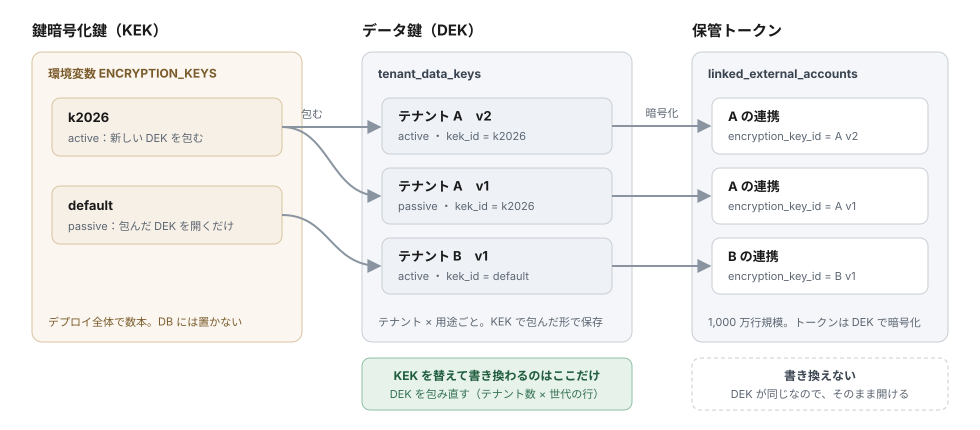
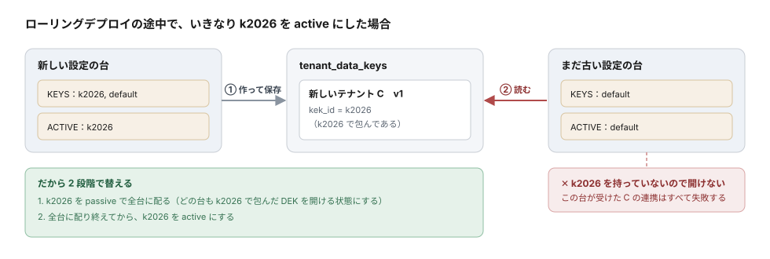
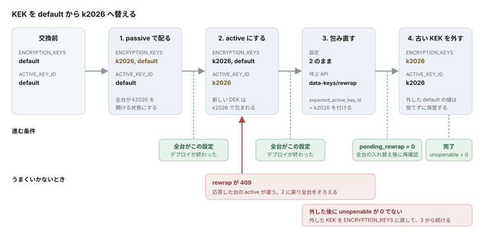
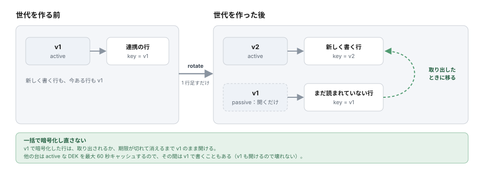

# データ鍵と鍵暗号化鍵のローテーション

アカウント連携で保管する外部IdPのトークンは、2 段の鍵で暗号化しています。このページは、その鍵を替える手順と、替えるときに確かめることをまとめたものです。

---

## 鍵の構成



KEK を替えて書き換わるのは、真ん中の `tenant_data_keys` だけです。DEK そのものは変わらないので、右の保管トークンの行には触れません。

| 鍵 | 置き場所 | 替えたときに書き換わるもの |
|---|---|---|
| KEK | 環境変数 `ENCRYPTION_KEYS` | `tenant_data_keys` の行（包み直し）。保管トークンは書き換わらない |
| DEK | `tenant_data_keys`（KEK で包んだ形） | 新しい世代を 1 行足すだけ。前の世代は開くためだけに残る |

保管トークンの行は `encryption_key_id` に DEK の id を持ちます。KEK を替えても DEK の id は変わらないため、保管トークンの行には触れません。

:::caution 対象はアカウント連携の保管トークンだけです
`oauth_token` の暗号化とトークンの検索用ハッシュは、これまでどおり `ENCRYPTION_KEY` を直接使います。`ENCRYPTION_KEYS` を設定しても `ENCRYPTION_KEY` は必須のままで、値を替えてはいけません。
:::

---

## 設定

| 環境変数 | 内容 | 未設定のとき |
|---|---|---|
| `ENCRYPTION_KEYS` | KEK の束。`<key id>:<base64 の鍵>` をカンマ区切り。鍵は 16 バイト以上 | `ENCRYPTION_KEY` を key id `default` の KEK として使う |
| `ENCRYPTION_ACTIVE_KEY_ID` | 新しく DEK を包む KEK の key id | `ENCRYPTION_KEYS` が無ければ `default`。`ENCRYPTION_KEYS` があるときは必須 |

```bash
# 例: k2026 で新しく包み、default（元の ENCRYPTION_KEY）で包まれた DEK も開ける
ENCRYPTION_KEYS="k2026:<base64>,default:<ENCRYPTION_KEY と同じ値>"
ENCRYPTION_ACTIVE_KEY_ID="k2026"
```

次の場合は起動時に失敗します。

- `ENCRYPTION_KEYS` があるのに `ENCRYPTION_ACTIVE_KEY_ID` が無い
- `ENCRYPTION_ACTIVE_KEY_ID` が `ENCRYPTION_KEYS` の中に無い
- 同じ key id が 2 回ある
- `<key id>:<base64 の鍵>` の形でない、または base64 として読めない
- 鍵が 16 バイトに満たない

KEK はそのまま使わず、包む用途の鍵を HKDF で派生させて使います。そのため、`default` の KEK は `ENCRYPTION_KEY` と同じ値でも、`oauth_token` の暗号化とは別の鍵になります。

---

## 状況の確認

```bash
curl -u "$IDP_SERVER_API_KEY:$IDP_SERVER_API_SECRET" \
  https://<host>/v1/admin/operations/data-keys
```

```json
{
  "active_key_id": "k2026",
  "configured_key_ids": ["k2026", "default"],
  "key_encryption_keys": [
    { "key_id": "k2026", "data_keys": 1180, "configured": true },
    { "key_id": "default", "data_keys": 20, "configured": true }
  ],
  "pending_rewrap": 20,
  "unopenable": 0
}
```

| 項目 | 意味 |
|---|---|
| `key_encryption_keys[].data_keys` | その KEK で包まれている DEK の数（破棄済みは数えない）|
| `pending_rewrap` | active でない KEK で包まれている DEK の数。0 になれば古い KEK を外せる |
| `unopenable` | このサーバーが持っていない KEK で包まれている DEK の数。**0 以外は設定の誤り**で、その DEK のテナントは保管トークンを開けない |

鍵そのもの（`wrapped_key` を含む）は返しません。

### DEK の一覧

件数ではなく DEK を 1 本ずつ見るときは、一覧を使います。テナントをまたいで引き、`tenant_id`・`kek_id`・`status`・`purpose` で絞り込めます（`limit` は 1〜1000、既定 20）。

```bash
curl -u "$IDP_SERVER_API_KEY:$IDP_SERVER_API_SECRET" \
  "https://<host>/v1/admin/operations/data-keys/list?kek_id=default&limit=100"
```

```json
{
  "list": [
    { "id": "…", "tenant_id": "…", "purpose": "account-linking-token", "version": 1,
      "status": "active", "kek_id": "default", "created_at": "…", "kek_configured": true }
  ],
  "total_count": 20,
  "limit": 100,
  "offset": 0
}
```

`kek_configured` は、応答した台がその KEK を持っているかです。`unopenable` が 0 でないときは、`key_encryption_keys` で `configured: false` の key id を `kek_id` に指定すると、開けなくなっているテナントが分かります。

テナントの管理者は、管理API（`GET .../tenants/{tenant-id}/data-keys`、権限 `idp:data-key:read`）で自分のテナントの DEK を見られます。こちらには、DEK ごとにその DEK で暗号化している連携の数（`linked_external_accounts`）が付きます。

---

## KEK を替える

KEK を替えるときは、必ず次の 2 段階で行います。いきなり active にすると、ローリングデプロイの途中で、新しい KEK を持たない台が新しい DEK を開けません。





1. **新しい KEK を passive で全台に配る**：`ENCRYPTION_KEYS` に足し、`ENCRYPTION_ACTIVE_KEY_ID` は今のままでデプロイする。
2. **新しい KEK を active にする**：全台に配り終えてから、`ENCRYPTION_ACTIVE_KEY_ID` を新しい key id にしてデプロイする。
3. **DEK を包み直す**：`pending_rewrap` が 0 になるまで繰り返す。

   ```bash
   curl -u "$IDP_SERVER_API_KEY:$IDP_SERVER_API_SECRET" \
     -H 'Content-Type: application/json' \
     -d '{"max_number": 1000, "expected_active_key_id": "k2026"}' \
     https://<host>/v1/admin/operations/data-keys/rewrap
   ```

   ```json
   { "rewrapped": 1000, "pending_rewrap": 180, "status": { "...": "状況の確認と同じ" } }
   ```

   `max_number`（1〜10000、既定 1000）で 1 回の件数を区切れます。前回の続きから進むので、途中で止めても再開できます。

   `expected_active_key_id` は必須です。応答した台の active な KEK と違えば `409` を返し、何も包み直しません。ローリングデプロイの途中で古い設定の台が受けて、DEK を古い KEK へ包み戻すのを防ぐためです。`409` のときは応答の `active_key_id` を見て、全台の設定がそろってからやり直してください。
4. **古い KEK を外す**：全台が新しい設定になったあとで `pending_rewrap` をもう一度確かめ、0 なら `ENCRYPTION_KEYS` から古い KEK を消してデプロイする。外した後に `unopenable` が 0 であることを確かめる。

   古い設定の台が残っている間は、その台が DEK を古い KEK で作ることがあります。包み直しが 0 になった後でも、全台の入れ替えが終わるまでは古い KEK を外さないでください。

`unopenable` が 0 でなくなったら、外した KEK を `ENCRYPTION_KEYS` に戻してください。戻せば、包み直しから続けられます。

---

## DEK の新しい世代を作る

```bash
curl -u "$IDP_SERVER_API_KEY:$IDP_SERVER_API_SECRET" \
  -H 'Content-Type: application/json' \
  -d '{"tenant_id": "<tenant id>", "purpose": "account-linking-token"}' \
  https://<host>/v1/admin/operations/data-keys/rotate
```

```json
{ "tenant_id": "<tenant id>", "purpose": "account-linking-token", "data_key_id": "<新しい DEK の id>" }
```



- 新しい保管トークンは新しい世代で暗号化します。前の世代は開くためだけに残り、一括で暗号化し直すことはしません。
- 前の世代の行は、トークンが取り出されたときに新しい世代へ移ります。
- 他の台は、active な DEK を最大 60 秒キャッシュします。その間は前の世代で書くことがありますが、前の世代も開けるので壊れません。
- 前の世代で暗号化した連携が残っているかは、管理API の一覧の `linked_external_accounts` で分かります。
- テナントの管理者も、管理API（`POST .../tenants/{tenant-id}/data-keys/rotate`、権限 `idp:data-key:rotate`）で新しい世代を作れます。`dry_run=true` で事前に確かめられ、監査ログに残ります。
- `purpose` を省くと `account-linking-token` です。`tenant_id` が無いか UUID でない場合と、`purpose` が他の値の場合は `400 invalid_request`、テナントが存在しない場合は `404` を返します。

---

## 漏えいが疑われるとき

暗号化し直しても、攻撃者がすでに持っている DB の写しは守れません。漏れたものに応じて対応します。

| 漏れたもの | できてしまうこと | 対応 |
|---|---|---|
| DB の写しだけ | 開けない（KEK が無い） | KEK を替える |
| KEK だけ | 開けない（包んだ DEK と暗号文が無い） | KEK を替える |
| KEK と DB の写し | 全テナントの保管トークンを読める | KEK を替えたうえで、保管トークンを連携先で失効させ、連携し直してもらう |

保管トークンをテナント単位でまとめて失効させる運用 API と、テナント内で一括で暗号化し直す運用 API はまだありません。失効は、連携の解除（`DELETE /{tenant-id}/v1/me/linked-external-accounts/{alias}`）か管理APIでの削除で、1 件ずつ行います。

---

## 確認手順

ローカルの docker compose 環境で、KEK の交換を通しで確かめるスクリプトがあります。サーバーを別の鍵設定で再起動しながら、KEK を足す → 包み直す → 古い KEK を外す → 早く外しすぎたときの検知 → 元に戻す、を順に行います。最後は元の設定に戻します。

```bash
e2e/scripts/kek-rotation.sh
```

通常の `npm test` には含まれません。リリース前や、鍵まわりを変えたときに実行してください。

---

## 関連ドキュメント

- [環境変数・セキュリティパラメータ設定](./02-environment-variables.md)
- [外部IdPアカウント連携](../../content_04_protocols/protocol-09-account-linking.md)
- [運用・保守](../../content_03_concepts/07-operations/concept-04-operations.md)
